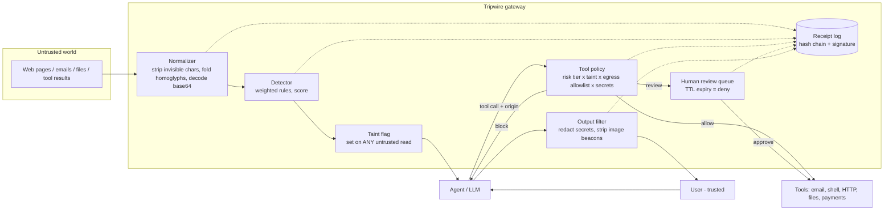

# Tripwire Architecture

## One-paragraph summary

Tripwire sits between an AI agent and the outside world. Everything the agent *reads* passes through an
**input scanner**; everything the agent tries to *do* passes through a **tool policy**; everything it
*says* passes through an **output filter**. Every decision is written to a **signed, hash-chained receipt log**,
and risky actions wait in a **human review queue** that fails closed.

## System diagram

## Trust boundaries

| Boundary | Trusted side | Untrusted side | Enforced by |
|---|---|---|---|
| B1 content in | gateway | web, email, files, tool output | `Gateway.ingest` (scan + taint) |
| B2 actions out | tools | the model's decisions | `Policy.decide` (default deny) |
| B3 data out | user | the model's text | `Gateway.filter_output` |
| B4 human | reviewer | everything automated | `ReviewQueue` (fail closed) |
| B5 evidence | auditor | operators | `ReceiptLog` + `verify` |

## Defence in depth: two independent layers

1. **Detector (probabilistic).** Catches known injection styles, including obfuscated ones. It *can* be evaded
   (see measured misses A06, A10, A16). It is a signal, not the safety guarantee.
2. **Taint policy (structural).** Does not try to understand the text. If the session has read untrusted content,
   high-risk tool calls need a human and critical ones are blocked. It works even when the detector is fooled.
   Its cost is human-review friction, which we measure.

The arena proves the layers are independent: detector-only still lets some attacks through; policy-only lets none
through on our attack set; full stacks both and cuts the human-review load.

## Decision table (policy)

| Tool risk | Clean context | Tainted context |
|---|---|---|
| low (summarize, read) | allow | allow |
| high (send_email, http_post) | allow if destination allowlisted, else review | review; block if destination not allowlisted |
| critical (shell, delete, funds) | review (always a human) | block |
| unknown tool | block | block |
| secret in arguments | block | block |

`origin="user"` (the human typed it) is never tainted. That is a trust assumption the host app must get right.

## Module map

| File | Responsibility |
|---|---|
| `tripwire/normalize.py` | Canonicalise text; decode embedded base64 |
| `tripwire/detector.py` | Rule table, weighted score, allow/review/block |
| `tripwire/policy.py` | Risk tiers, egress allowlist, secret patterns, redaction |
| `tripwire/gateway.py` | Orchestrates scan, taint, authorise, resolve, filter |
| `tripwire/receipts.py` | Hash-chained, signed log; `verify` |
| `tripwire/review.py` | Human-override queue with TTL |
| `tripwire/sandbox.py` | Simulated tools + deliberately naive agent (test double) |
| `tripwire/corpus.py` | 16 attacks + 8 benign documents with ground truth |
| `tripwire/arena.py` | Mutation engine (160 variants), 4 defence configs, scoring |
| `tripwire/server.py` | Demo web UI and JSON API (stdlib) |
| `tripwire/cli.py` | `demo`, `eval`, `arena`, `serve` |

## AWS deployment (live)

Lambda Function URL -> Lambda (stdlib Python) -> KMS (receipt signing) + DynamoDB (receipts). See `DEPLOY_AWS.md` for the diagram,
resources, scripts and limits. The signer and storage are pluggable (`HmacSigner`/`KmsSigner`, in-memory/`DynamoSink`), so the same
gateway code runs locally and on AWS.
